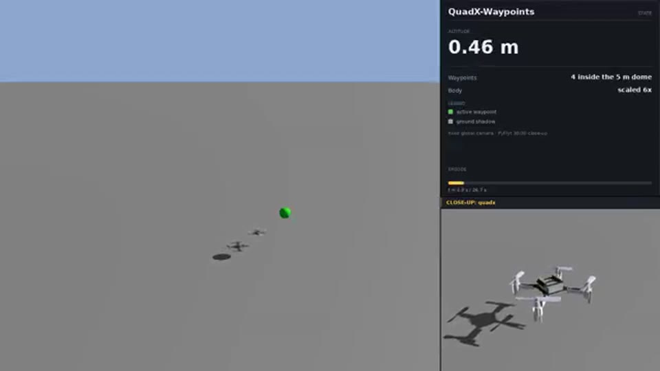
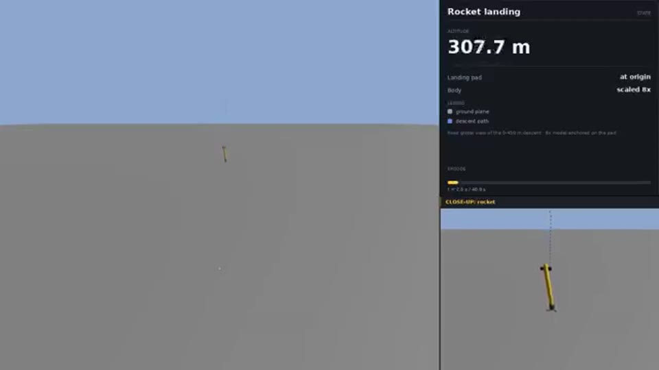
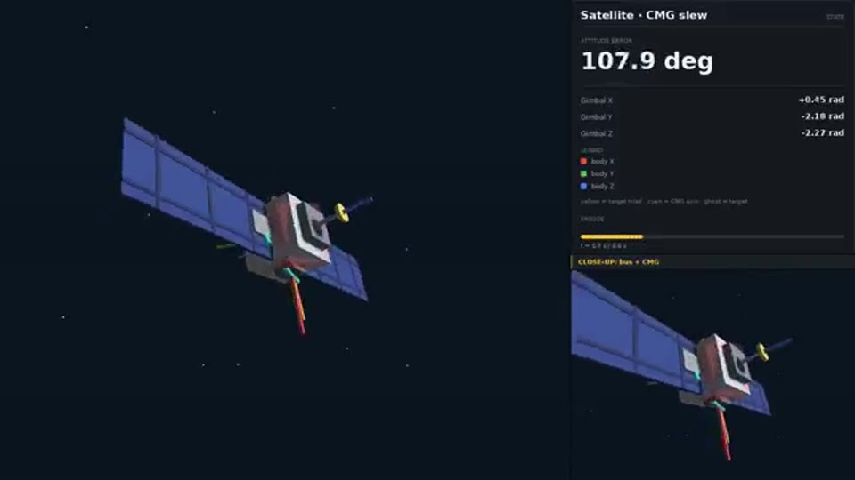
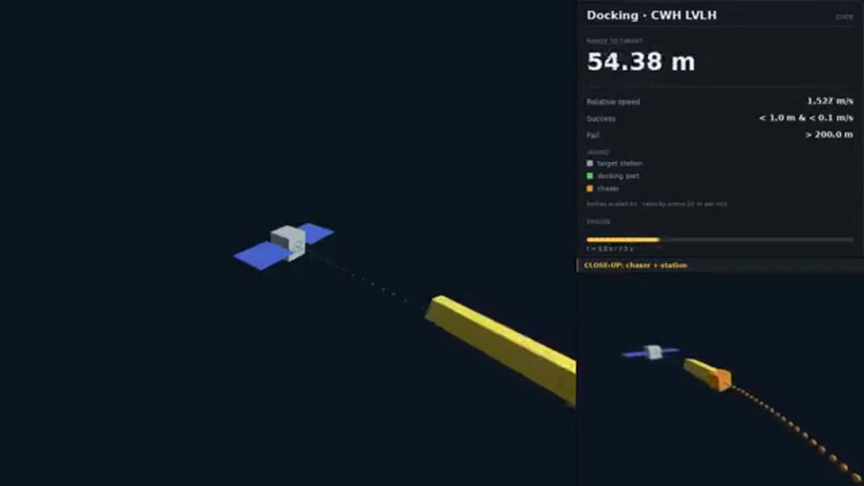

# AerospaceRL Benchmark

Ten GPU-parallel aerospace control tasks with a unified tensor interface, classical GNC baselines and reproducible evaluation.

[English](README.md) | [简体中文](README.zh-CN.md) | [Website / 项目网页](https://paoshou-china.github.io/aerospace-rl-benchmark/)

| QuadX | Rocket | Satellite | Docking |
|---|---|---|---|
|||||

## Quick start

```bash
git clone https://github.com/PaoShou-China/aerospace-rl-benchmark.git
cd aerospace-rl-benchmark
python -m pip install -r requirements.txt
python environments/multirotor/train_quadx.py
python scripts/baseline_eval.py quadx
```

## Tasks

| Task | Model | Obs / Act | Documentation |
|---|---|---|---|
| QuadX-Waypoints | URDF / Genesis | 37 / act 4 | [Specification](docs/method/README.md) |
| QuadX-Track | URDF / Genesis | 25 / act 4 | [Specification](docs/method/README.md) |
| Fixedwing-Waypoints | URDF / Genesis | 39 / act 4 | [Specification](docs/method/README.md) |
| Quadplane-VTOL | URDF / Genesis | 47 / act 8 | [Specification](docs/method/README.md) |
| Rocket-Landing | URDF / Genesis | 30 / act 7 | [Specification](docs/method/README.md) |
| Missile-Intercept | URDF / Genesis | 34 / act 3 | [Specification](docs/method/README.md) |
| Satellite Attitude | Tensor dynamics | 26/32 / act 4/6 | [Specification](docs/method/README.md) |
| Low-Thrust Transfer | Tensor dynamics | 8 / act 3 | [Specification](docs/method/README.md) |
| Space Docking | Tensor dynamics | 6 / act 3 | [Specification](docs/method/README.md) |
| Space Rendezvous | Tensor dynamics | 6 / act 3 | [Specification](docs/method/README.md) |

## Documentation

- [完整技术说明 / Full technical details](docs/benchmark-details.md)
- [任务与算法 / Tasks and methods](docs/method/README.md)
- [评测协议 / Evaluation protocol](docs/evaluation_protocol.md)
- [基线结果 / Baseline report](docs/baseline_test_report.md)
- [实现细节 / Infrastructure](docs/technical-highlights.md)

Physics uses float64; observations and rewards use float32. Baseline replica counts, seeds, windows and success definitions vary; consult the full technical details before comparing results.
