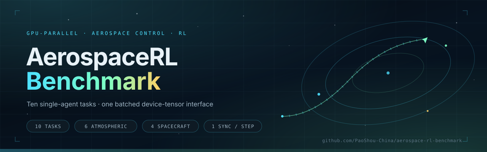

# AerospaceRL Benchmark

<p align="center">
  <a href="https://paoshou-china.github.io/aerospace-rl-benchmark/">
    
  </a><br>
  <a href="https://paoshou-china.github.io/aerospace-rl-benchmark/"><b>https://paoshou-china.github.io/aerospace-rl-benchmark/</b></a>
</p>

**GPU-parallel reinforcement learning environments for aerospace control.**
Ten single-agent tasks — six atmospheric vehicles on a URDF rigid-body backend,
four spacecraft missions on explicit tensor dynamics — behind one batched
device-tensor interface. No Gym / Gymnasium wrappers.

<p align="center">
  <a href="https://paoshou-china.github.io/aerospace-rl-benchmark/"><b>▶ Live showcase</b></a>
  &nbsp;·&nbsp;
  <a href="docs/technical-highlights.md">Technical highlights</a>
  &nbsp;·&nbsp;
  <a href="docs/evaluation_protocol.md">Evaluation protocol</a>
  &nbsp;·&nbsp;
  <a href="docs/method/README.md">Method docs</a>
  &nbsp;·&nbsp;
  <a href="benchmark_report.md">Benchmark report (中文)</a>
</p>

## What is here

- **10 tasks** sharing one `step` / `reset` / buffer contract, so every training
  entry treats them uniformly.
- **A classical GNC baseline for every task**, using the same action convention
  as the learned policy. Each baseline can be evaluated directly, cloned into a
  warm start, or used as the base controller of a residual policy.
- **One device, one host sync per step.** Physics state is `float64`,
  observations and rewards `float32`; physics, contacts, reward, reset and RNG
  are masked tensor kernels, so inactive replicas are frozen and draw no random
  numbers. The only per-step host sync is `bool(done.any())`, which gates
  episode-boundary bookkeeping.

Design claims and their verification conditions are written up in
[docs/technical-highlights.md](docs/technical-highlights.md).

## Environments

| Task | Class | Dynamics | Obs | Act | Policy rate | Episode | Success criterion |
|---|---|---|---|---|---|---|---|
| QuadX-Waypoints | `QuadXWaypointsEnv` | URDF Crazyflie 2.x (240 Hz) + rate PID | 37 | 4 | 40 Hz | 800 steps · 20 s | 4/4 waypoints < 0.2 m |
| QuadX-Track | `QuadXTrackEnv` | URDF Crazyflie 2.x (240 Hz) + rate PID, kinematic ground target, geometric camera | 25 | 4 | 40 Hz | 1200 steps · 30 s | visible-time fraction ≥ 0.85, no crash |
| Fixedwing-Waypoints | `FixedwingWaypointsEnv` | URDF 2.35 kg UAV (240 Hz) + blade-element aero | 39 | 4 | 30 Hz | 3600 steps · 120 s | 4/4 waypoints < 10 m |
| Quadplane-VTOL | `QuadplaneWaypointsEnv` | URDF hybrid UAV (240 Hz): 4 quad motors, fixed-wing surfaces, forward pusher | 47 | 8 | 40 Hz | 1200 steps · 30 s | 4/4 waypoints < 15 m |
| Rocket-Landing | `RocketLandingEnv` | URDF F9-class booster (240 Hz) + grid fins, gimbal | 30 | 7 | 40 Hz | 1200 steps · 30 s | pad contact, \|v\| < 0.02 m/s, \|ω\| < 0.02 rad/s, tilt < 0.1 rad for 2 s (81 samples) |
| Missile-Intercept | `MissileInterceptEnv` | URDF 150 kg missile (240 Hz) + tail-fin aero, boost-coast engine, kinematic 3-DOF target | 34 | 3 | 60 Hz | 900 steps · 15 s | miss distance < 15 m (proximity fuse, any physics substep) |
| Satellite attitude (CMG) | `SatelliteAttitudeEnv` | rigid body + 4/6-CMG cluster, RK4 2.5 ms | 26 / 32 | 4 / 6 | 40 Hz | 1200 steps · 30 s | att. error < 0.05 rad and \|ω\| < 0.02 rad/s; \|ω\| > 10 rad/s fails |
| Low-thrust transfer | `LowThrustTransferEnv` | two-body gravity + 3-axis 10 mN EP, RK4 10 s | 8 | 3 | 300 s/step | 166 steps ≈ 5 revs | terminal orbital-element return R > 0 at the limit |
| Docking | `SpaceDockingEnv` | Clohessy–Wiltshire–Hill, symplectic Euler 1 s | 6 | 3 | 1 s/step | 500 steps ≈ 8.3 min | range < 1 m, speed < 0.1 m/s |
| Rendezvous | `SpaceRendezvousEnv` | Clohessy–Wiltshire–Hill, symplectic Euler 1 s | 6 | 3 | 1 s/step | 1000 steps ≈ 16.7 min | range < 10 m, speed < 0.5 m/s, keep-out respected |

The six Genesis rigid-body tasks (`quadx`, `quadx_track`, `fixedwing`,
`quadplane`, `rocket`, `missile`) use fully tensorized actuation and contact
layers; the missile's manoeuvring target and the QuadX-Track ground target plus
its camera are analytic geometry advanced each physics substep. The four space
tasks (`satellite`, `transfer`, `docking`, `rendezvous`) are pure-tensor
integrators with no engine.

Full layouts, reward decompositions, termination conditions and spawn
distributions live in each package docstring:
[multirotor](environments/multirotor/__init__.py) ·
[fixedwing](environments/fixedwing/__init__.py) ·
[vtol](environments/vtol/__init__.py) ·
[rocket](environments/rocket/__init__.py) ·
[missile](environments/missile/__init__.py) ·
[attitude_control](environments/satellite/attitude_control/__init__.py) ·
[orbit_transfer](environments/satellite/orbit_transfer/__init__.py) ·
[rendezvous_docking](environments/satellite/rendezvous_docking/__init__.py).
Paper-style method write-ups are indexed in
[docs/method/README.md](docs/method/README.md).

## Classical baselines

Every task ships a non-learned GNC baseline
([algorithms/baselines/](algorithms/baselines/baselines.py)) on the same env,
reward and success bar as the policy. Controllers read only the `'policy'`
observation group, take env constants at construction, and never touch internal
state buffers.

| Task | Baseline | Reference success |
|---|---|---|
| QuadX-Waypoints | SE(3) geometric control + integral trim | 90.6% (32 replicas, seed 7); 99.7% mean over the multi-seed protocol (128 replicas × seeds 7/13/21; held-out seed 101 = 100%) |
| QuadX-Waypoints | position PID → attitude cascade | 99.2% (256 replicas, seed 7, 0 crash / OOB) |
| QuadX-Track | CV Kalman filter + fixed-offset SE(3) | 82.8% (128 replicas, seed 21); 90.2% visible time, 0.258 m standoff |
| Fixedwing-Waypoints | L1 lateral + TECS longitudinal autopilot | 97.0% (128 replicas, seed 13; the window ends before the 120 s limit) |
| Quadplane-VTOL | SE(3) + forward pusher | 89.1% (128 replicas, seed 13) |
| Rocket-Landing | PDG: ZEM/PN braking + virtual-pad manifold + pulse servo | 100% under the v2 criterion (40 Hz, continuously settled for 2 s) |
| Satellite (CMG) | quaternion PD + Schaub–Junkins damped pseudo-inverse | 100% (128 replicas, seed 13) |
| Transfer | Gauss one-step greedy tangential guidance | 100% (128 replicas, seed 13) |
| Docking | CWH discrete LQR + shield/fuel derating | 100% (128 replicas, seed 13) |
| Rendezvous | two-impulse CWH ZEM/PN, recursive re-solve | 100% (128 replicas, seed 13) |
| Missile-Intercept | augmented PN (N = 15) → body-rate commands | 71.1% (128 replicas, seed 13) |

Numbers are the shipped `results/<task>/baseline.json` artifacts; each file
records its own replica count, seed and step window. Within-task ablations
(256 replicas, seed 7) sit in `results/<task>/baselines/`, and the multi-seed
protocol reanalysis is in
[docs/baseline_test_report.md](docs/baseline_test_report.md).

Two readings worth keeping:

- These are references, not strawmen. The fixed-wing and rocket baselines keep
  documented residual failures (endgame limit cycles, authority-saturated
  braking) that a learned policy is expected to attack.
- The rocket v1 figures in older notes (82.8% / 84.1%) are **instantaneous**
  success rates and are not comparable to the v2 settled criterion. Background
  and reproduction commands: [docs/rocket_benchmark_v2_zh.md](docs/rocket_benchmark_v2_zh.md).

## Environment contract

- `obs_buf` / `rew_buf` are `float32`, internal physics state is `float64`.
- `extras['time_outs']` marks pure time-limit truncations (for rsl-rl
  time-limit bootstrapping); `extras['terminal_observations']` carries the
  pre-reset observation.
- `completed_episodes` / `completed_successes` / `completed_returns`
  accumulate on device; `complete` is the per-replica success flag.
- Actions arrive on `env.device`; implicit host/device copies raise.

## Wind disturbance

Five atmospheric tasks (QuadX-Waypoints, Fixedwing-Waypoints, Quadplane-VTOL,
Rocket-Landing, Missile-Intercept) accept optional wind:

- `steady_wind` (tuple, m/s) — constant world-frame wind velocity;
- `dryden` (0–1 scale of the severity presets) + `severity`
  (`light | moderate | severe`) — Dryden gusts from
  [environments/common/disturbances.py](environments/common/disturbances.py),
  advanced once per control step.

Aerodynamic terms always evaluate air-relative velocity `v_air = v - wind`,
so calm air (`steady_wind=None, dryden=0`) reproduces the benchmark
bit-for-bit. `eval.py` restores each run's recorded `env_kwargs`, so a
checkpoint trained in wind is evaluated in the same wind.

| Task | Training-entry wind |
|---|---|
| quadx, fixedwing, quadplane | pure Dryden gusts, `dryden=0.3, severity="moderate"` |
| rocket | `dryden=0.0` (same caliber as the calm-air baseline) |
| missile, quadx_track | calm air |
| satellite, transfer, docking, rendezvous | vacuum |

## Installation

```bash
python -m pip install -r requirements.txt
```

Exact versions are pinned in [requirements.txt](requirements.txt); the
reference environment is Python 3.10.20 with PyTorch 2.11.0 (CUDA 12.8),
`genesis-world` 1.4.4, `rsl-rl-lib` 5.3.0, NumPy 2.2.6 and SciPy 1.15.3 on
Linux (RTX 3090, driver 580.173.02).

A CUDA build of PyTorch is required for the six Genesis tasks on the GPU
backend; the four tensor-dynamics tasks and every classical baseline also run
on CPU-only PyTorch. `gymnasium` / `pettingzoo` are not dependencies of this
suite.

## Quick start

Training entries are self-contained: every parameter is hard-coded in the file,
there are no CLI arguments. Edit the constants and run:

```bash
python environments/multirotor/train_quadx.py
python environments/multirotor/train_quadx_track.py
python environments/fixedwing/train_fixedwing.py
python environments/vtol/train_quadplane.py
python environments/rocket/train_rocket.py
python environments/missile/train_missile.py
python environments/satellite/attitude_control/train_satellite.py
python environments/satellite/orbit_transfer/train_transfer.py
python environments/satellite/rendezvous_docking/train_docking.py
python environments/satellite/rendezvous_docking/train_rendezvous.py
```

Evaluate a checkpoint, or the classical baseline:

```bash
python scripts/eval.py quadx                # restores results/<task>/config.json
python scripts/eval.py quadplane
python scripts/baseline_eval.py quadx       # any registered task
python scripts/baseline_eval.py satellite --baseline quat_pd_mp_pinv_cmg
python scripts/aggregate_5seed.py           # multi-seed protocol summary
```

The legacy CLI aggregator still works for quick sweeps
(`python scripts/train.py quadx`; it registers quadx, fixedwing, rocket,
missile, satellite, transfer, docking, rendezvous — `quadx_track` and
`quadplane` use their per-task entries above).

Each run writes `results/<task>/`: `run.json` (config, real transition counts,
physical-step counts, device-side completion metrics), `config.json`,
`checkpoint.pt`, plus `eval.json` when evaluated. Baseline artifacts are
`baseline.json` (default controller) and `baselines/<controller>_seed7.json`
(within-task ablations).

## Repository layout

```text
environments/               # everything that defines a task
├── multirotor/             # QuadX-Waypoints + QuadX-Track
├── fixedwing/              # Fixedwing-Waypoints
├── vtol/                   # Quadplane-VTOL
├── rocket/                 # Rocket-Landing
├── missile/                # Missile-Intercept
├── satellite/              # attitude_control, orbit_transfer, rendezvous_docking
└── common/                 # plant, dynamics, aero, contacts, disturbances
algorithms/                 # everything that produces actions
├── train_utils.py          # shared run_training() used by every entry
├── ppo/                    # rsl-rl PPO config builder
├── warmstart/              # behavior-cloning warm start from baselines
├── residual/               # residual-RL action wrapper
└── baselines/              # classical GNC controllers, one per task
experiments/                # controller-prior studies (BC, residual, gain scheduling)
scripts/                    # generic train / eval / baseline / sweep / summarize tools
docs/                       # method-level write-ups, protocol, technical highlights
showcase/                   # replay clips used by the GitHub Pages landing page
tests/                      # unit, env-contract and benchmark tests
```

Per-task deep-dive harnesses live next to their environments (for example
`environments/missile/eval_missile_scenarios.py`,
`environments/rocket/rocket_pdg_test.py`,
`environments/satellite/rendezvous_docking/eval_docking_lqr.py`).

## Documentation

| Document | Contents |
|---|---|
| [docs/method/README.md](docs/method/README.md) | per-task and per-algorithm method docs (notation, equations, constants) |
| [docs/evaluation_protocol.md](docs/evaluation_protocol.md) | evaluation protocol and reporting rules |
| [docs/baseline_test_report.md](docs/baseline_test_report.md) | multi-seed baseline reanalysis |
| [docs/technical-highlights.md](docs/technical-highlights.md) | reviewer-oriented infrastructure claims |
| [benchmark_report.md](benchmark_report.md) | 中文基准报告 |
| [docs/rocket_benchmark_v2_zh.md](docs/rocket_benchmark_v2_zh.md) | 火箭 v2 判据与复现说明 |

## Planned tasks

Every future task follows the same recipe: tensorized env + spec docstring →
classical baseline registered in `algorithms/baselines/` → self-contained
`train_<task>.py` → `results/<task>/` → README update. All tasks are
single-agent.

**Priority 1**

| Task | Environment | Baseline | Interest |
|---|---|---|---|
| Droneship Landing | Rocket-Landing + 6-DOF moving pad (sea-wave spectrum) | PDG + lag-compensated retargeting | moving touchdown target |
| Docking-Fault | Docking + stuck/dead thrusters + measurement noise | LQR + control reallocation | fault injection, safe RL |
| Autoland | glide slope + crosswind + flare, runway-contact criteria | glide-slope guidance + TECS | autopilot already exists |
| Slung Payload | QuadX + cable-suspended pendulum load | SE(3) + swing damping | underactuated coupling |

**Priority 2**

| Task | Environment | Baseline | Interest |
|---|---|---|---|
| Terrain Following | DEM sampling, radar-altimeter observations | TF-lateral guidance | local observations |
| Inspection | CWH + field-of-view constraint, coverage reward | ZEM/PN fly-around | long horizon |
| RTB Boost-back | ascent + 180° flip + landing, ~90 s | gravity turn + two-phase PDG | long-horizon shaping |
| HGV Glide | hypersonic glide, heat-flux / load-factor corridor | BTT corridor guidance | constraint satisfaction |
| Racing Gate | gate sequence, time penalty + speed cap | minimum-time tracking | aggressive flight |

**Priority 3**

| Task | Environment | Baseline | Interest |
|---|---|---|---|
| GEO Station-keeping | perturbed two-body (J2 + sun/moon), ±0.05° deadband | impulsive Euler–Hill corrections | very low control budget |
| Ascent to Orbit | gravity turn, dynamic-pressure / heat-flux limits | linear-tangent guidance | completes launch → orbit → rendezvous |
| Detumble & Capture | tumbling non-cooperative target, contact dynamics | angular-momentum matching | contact-rich manipulation |
| Precision Landing | moving cart pad + simulated vision latency | MPC-style tracking | latency-robust observation |

Landed infrastructure: the unified `WindDisturbance` in
`environments/common/disturbances.py` and the baseline registry
(`@register_baseline('<task>')` — one line wires a new controller into
`baseline_eval.py`).

## References

This suite reproduces or adapts the following published tasks; each
environment docstring lists the source of its defaults.

**Tasks and vehicle models**

1. Tai, J. K. *PyFlyt: UAV Simulation and Reinforcement Learning Environments*
   — task definitions, reward shaping and the cf2x / fixedwing / rocket
   URDF-YAML models (PyFlyt 0.29.0).
2. TorchRL contributors. *SatelliteEnv* — reward weights, tolerances and reset
   distribution of the CMG attitude task.
3. Casas, R., Carro, A. & Sanchez-Esguevillas, J. "Low-Thrust Orbital Transfer
   using Dynamics-Agnostic Reinforcement Learning" (arXiv:2211.08272) and its
   companion code — the perigee-raising task, reproduced parameter for
   parameter.
4. Supreeth, H. S. G. & Mehta, V. "SpaceGym: A Gymnasium-Based Benchmark for
   Deep Reinforcement Learning in Spacecraft Proximity Operations", CVPR 2026
   Workshop on AI4Space (CC BY 4.0) — docking / rendezvous dynamics, task table
   and reward weights.

**Dynamics and GNC**

5. Clohessy, W. H. & Wiltshire, R. S. (1960). "Terminal Guidance System for
   Satellite Rendezvous" — the linearized relative-motion model.
6. Wie, B. (2008). *Space Vehicle Dynamics and Control* — CMG momentum
   geometry and the singularity metric.
7. Vallado, D. A. *Fundamentals of Astrodynamics and Applications* —
   Kepler-to-Cartesian conversion and osculating-orbit recovery.
8. Lee, T., Leok, M. & McClamroch, N. H. (2010). "Geometric Tracking Control of
   a Quadrotor UAV on SE(3)", CDC — the QuadX geometric baseline.
9. Park, S., Deyst, J. & How, J. P. (2004). "A New Nonlinear Guidance Logic for
   Trajectory Tracking", AIAA GNC — the fixed-wing L1 lateral guidance.

**Infrastructure**

10. Genesis contributors. *Genesis* — rigid-body engine and tensor API.
11. Legged Robotics group, ETH Zürich. *rsl_rl* — PPO training backend.
