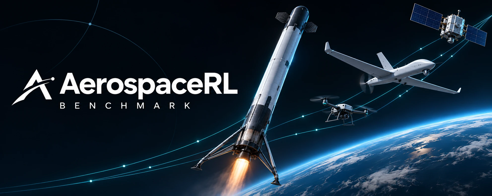

Ten GPU-parallel aerospace control tasks with a unified tensor interface, classical GNC baselines and reproducible evaluation.

<p align="center"><a href="README.md">English</a> · <a href="README.zh-CN.md">简体中文</a> · <a href="https://paoshou-china.github.io/aerospace-rl-benchmark/">Project website</a> · <a href="docs/method/README.md">Documentation</a></p>

## Quick start

```bash
git clone https://github.com/PaoShou-China/aerospace-rl-benchmark.git
cd aerospace-rl-benchmark
python -m pip install -r requirements.txt
python environments/multirotor/train_quadx.py
python scripts/baseline_eval.py quadx
```

## Tasks

| Task | Model | Obs / Act | Documentation |
|---|---|---|---|
| QuadX-Waypoints | URDF / Genesis | 37 / act 4 | [Specification](docs/method/README.md) |
| QuadX-Track | URDF / Genesis | 25 / act 4 | [Specification](docs/method/README.md) |
| Fixedwing-Waypoints | URDF / Genesis | 39 / act 4 | [Specification](docs/method/README.md) |
| Quadplane-VTOL | URDF / Genesis | 47 / act 8 | [Specification](docs/method/README.md) |
| Rocket-Landing | URDF / Genesis | 30 / act 7 | [Specification](docs/method/README.md) |
| Missile-Intercept | URDF / Genesis | 34 / act 3 | [Specification](docs/method/README.md) |
| Satellite Attitude | Tensor dynamics | 26/32 / act 4/6 | [Specification](docs/method/README.md) |
| Low-Thrust Transfer | Tensor dynamics | 8 / act 3 | [Specification](docs/method/README.md) |
| Space Docking | Tensor dynamics | 6 / act 3 | [Specification](docs/method/README.md) |
| Space Rendezvous | Tensor dynamics | 6 / act 3 | [Specification](docs/method/README.md) |

## Documentation

- [完整技术说明 / Full technical details](docs/benchmark-details.md)
- [任务与算法 / Tasks and methods](docs/method/README.md)
- [评测协议 / Evaluation protocol](docs/evaluation_protocol.md)
- [基线结果 / Baseline report](docs/baseline_test_report.md)
- [实现细节 / Infrastructure](docs/technical-highlights.md)

Physics uses float64; observations and rewards use float32. Baseline replica counts, seeds, windows and success definitions vary; consult the full technical details before comparing results.

## Acknowledgments

We thank Professors Lin Cheng (程林), Shengping Gong (龚胜平), and Peng Shi (师鹏), and fellow students Wang Han (王翰), Shi Yunhan (史运翰), Gong Yuxuan (龚钰轩), and Dai Yuhang (代雨航) for their support and help with this project.

We also thank the following open-source projects and their contributors for simulation engines, tensor computation, training tools, model assets, and task references:

[Genesis](https://github.com/Genesis-Embodied-AI/Genesis), [PyTorch](https://github.com/pytorch/pytorch), [rsl-rl](https://github.com/leggedrobotics/rsl_rl), [PyFlyt](https://github.com/jkuang421/PyFlyt), [TorchRL](https://github.com/pytorch/rl), [gym-satellite-trajectory](https://github.com/zampanteymedio/gym-satellite-trajectory).

We also acknowledge SpaceGym and the authors of related research. Task provenance and citations are listed in the full technical details. Each upstream project retains its own license and citation requirements.
