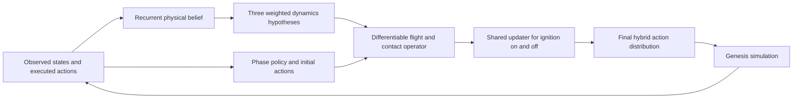

# Physical-Belief Control for Rocket Landing

[English](README.md) | [中文](README.zh-CN.md)

## Abstract

This work integrates online dynamics identification, differentiable physical prediction, and action optimization into a single policy network for the aerospace-rl-benchmark rocket-landing task. The policy maintains a recurrent **physical belief**—an estimate of effective dynamics parameters inferred from executed actions and observed state changes. It uses a shared physics operator to predict candidate-action outcomes and a learned update module to perform a finite number of identification and control steps. The final policy combines discrete ignition with conditional continuous controls, trained with PPO on simulator returns and an auxiliary prediction loss on real transitions.

On the frozen benchmark environment and the same 512 initial states, the physical-belief policy achieves **428/512 successes (83.59%)**, compared with **419/512 (81.84%)** for its DAgger initialization: a net gain of 9 episodes, or **1.76 percentage points**. This directory contains the implementation, training configuration, checkpoints, and episode-level evaluation records.

## 1. Task and architecture

The rocket controls its fins, engine, and gimbal during powered descent and landing. The policy receives the environment's 30-dimensional observation and outputs one ignition variable plus six continuous controls. Simulation runs at 240 Hz, control at 40 Hz, and each episode lasts at most 1,200 control steps.



The main computation is

$$
b_t=\mathcal I_\psi(b_{t-1},s_{t-1},a_{t-1},s_t),\qquad
\hat s_{t+1}=F(s_t,a_t;\theta_t),\qquad
a_t\sim\pi_\psi(\cdot\mid s_t,b_t).
$$

Here, $b_t$ is the physical belief updated from actual interaction, and $F$ is the differentiable physics operator used to evaluate and refine candidate actions. Identification and control share a learned updater; prediction advances the state directly through the same physics operator.

## 2. Model design

### 2.1 Recurrent physical belief

The internal physical state has 21 dimensions: position, world-frame velocity, quaternion, angular velocity, fin state, engine state, gimbal state, and fuel fraction. A `GRUCell(50, 64)` encodes the previous state, executed action, and observed changes. Each environment maintains an 88-dimensional memory: 64 hidden features, 12 parameter means, and 12 scales.

| Parameter group | Dimensions | Physical role |
|---|---:|---|
| Effective thrust-to-mass gain | 1 | Relates propulsion input to translational acceleration |
| Three-axis drag gains | 3 | Velocity-dependent resistance along each axis |
| Transverse and axial inertia gains | 2 | Relates torque to angular acceleration |
| Fin aerodynamic gain | 1 | Fin forces and moments |
| Engine and gimbal response gains | 2 | Actuator response |
| Contact stiffness, damping, and friction gains | 3 | Landing-leg contact and tangential sliding |

Three parameter hypotheses are constructed from the mean and positive/negative perturbations along a fixed direction. Each hypothesis predicts the next observation under the action actually executed; prediction residuals determine its weight and update the recurrent belief. The inferred quantities are effective dynamics coefficients relevant to this task.

### 2.2 Differentiable physics operator

The flight operator includes six-degree-of-freedom rigid-body dynamics, fuel-dependent mass and inertia, gravity, drag, fin lift and moments, thrust vectoring, and actuator response. It advances at a 40 Hz macro step and analytically computes the endpoint and mean actuator response across six 240 Hz substeps.

The contact operator uses 12 bottom corners across three landing legs to compute compliant normal forces, damping, and smooth sliding friction against the pad and ground. This layer is a differentiable contact approximation; the original Genesis environment supplies actual interactions, contact events, and returns.

### 2.3 Shared identification and control updater

`SharedPhysicalUpdate` predicts a coordinate-wise step size from the current variables, physical-cost gradient, history context, variable type, and task mode:

$$
z^{i+1}=z^i-\eta_\psi(z^i,\nabla_z E,c,\mathrm{type},\mathrm{mode})
\odot\tanh(\nabla_z E).
$$

Identification updates the dynamics hypotheses; control updates actions. Both use the same network weights and unroll two updates. The hypotheses obtained from interaction remain fixed during that control solve. Prediction loss on actual transitions trains the belief branch.

### 2.4 Action initialization and risk-sensitive control

The DAgger initialization uses a shared feature trunk and three height-dependent experts, with phase boundaries at 10 m and 2 m. Action heads produce continuous initial actions near this policy for separate ignition-on and ignition-off branches.

Within each branch, the same candidate action is evaluated under all three physics hypotheses over **8 control steps (0.2 seconds)**. The action is held constant across this horizon. The objective includes descent velocity, lateral centering, attitude, angular velocity, and deviation from the reference action. Risk combines the weighted mean and worst hypothesis cost:

$$
J(a)=(1-\rho)\sum_k w_kJ_k(a)+\rho\max_kJ_k(a)
+3\lVert a-a_{\mathrm{ref}}\rVert^2.
$$

The refined continuous action is blended with its initialization according to height:

$$
\mu=a_0+\alpha(h)(a^*-a_0),\qquad
\alpha(h)=\sigma(\beta)\sigma((20-h)/3).
$$

The released checkpoint has $\sigma(\beta)\approx0.2495$ and $\rho\approx0.2497$. The final policy is a joint distribution consisting of an ignition Bernoulli and the corresponding six-dimensional Gaussian. PPO probability ratios, entropy, and KL are computed from this final distribution.

## 3. Training method

Training combines PPO, value estimation, physical prediction, entropy, action anchoring, and a KL penalty:

$$
\mathcal L=\mathcal L_{\mathrm{PPO}}+0.5\mathcal L_V
+0.1\mathcal L_{\mathrm{pred}}-0.001\mathcal H
+0.002\mathcal L_{\mathrm{anchor}}
+0.0001\mathcal L_{\mathrm{control}}+\mathcal L_{\mathrm{KL}}.
$$

Prediction supervision uses executed actions and their actual successor observations. Termination and time-limit truncation are handled separately; timeout bootstrapping uses the state before reset. Each iteration also takes four-step sequences from up to 16 environments for one truncated backpropagation update through recurrent belief.

The training reward combines potential differences, velocity and attitude tracking costs, a first-success bonus, collision penalties, risk costs, and post-success settling rewards. The `settle` recipe accumulates settling rewards in the 64-step window after first success and can terminate training episodes once that time condition is reached and the rocket is currently settled. Evaluation retains the original termination rules.

| Setting | Recorded configuration |
|---|---:|
| Actor parameters / added parameters | 340,658 / 63,382 |
| Parallel environments / rollout length | 2,048 / 64 |
| Sampled transitions per iteration | 131,072 |
| PPO epochs / minibatch | 2 / 131,072 |
| Initial training microbatch | 32,768; adjusted to GPU memory |
| GPU memory target fraction | 0.94 |
| Seed policy / added modules / critic learning rates | $5\times10^{-6}$ / $3\times10^{-5}$ / $10^{-4}$ |
| Discount / GAE coefficient | 0.999 / 0.98 |
| PPO clip / target joint KL | 0.1 / 0.02 |
| Training seed | 730007 |
| Transitions at continuation start | 2,031,616 |
| Transitions added in this run | 4,194,304 |
| Cumulative transitions in checkpoint lineage | 6,225,920 |

The implementation combines batched GPU simulation, chunked inference, and training microbatches. Chunk sizes adapt to measured peak memory and available capacity; an uncommitted batch is retried at a smaller size after an out-of-memory error. Evaluation runs in separate processes after training releases its graphs and optimizer memory. Continuation restores the model and optimizer and starts fresh simulator episodes.

## 4. Evaluation protocol and results

The environment is frozen at upstream commit `39e6bb6fd5d0f5432f7405a76946938a469492ce`, preserving the original dynamics, float32 engine precision, and success criterion. Evaluation uses four cohorts of 128 environments with seeds `1000007 / 2000007 / 3000007 / 4000007`. Only the first episode of each environment is counted, with deterministic policy actions. Initial-state hashes match between the two policies in every cohort.

| Policy | Successful episodes | Benchmark success rate | 95% Wilson interval |
|---|---:|---:|---:|
| DAgger initialization | 419 / 512 | 81.84% | 78.26%–84.93% |
| Physical-belief policy | 428 / 512 | **83.59%** | 80.14%–86.55% |

On paired initial states, the new policy gains 79 successful episodes and loses 70, for a net gain of 9. This comparison measures the overall change from the DAgger initialization to the continued physical-belief policy. The reference is the DAgger initialization, and this single training run does not isolate the contribution of any individual module.

Benchmark success records whether the episode ever meets the contact, velocity, angular-velocity, and tilt thresholds. Terminal outcomes are recorded separately: 3/512 physical-belief episodes are settled at termination, and 214/512 meet success before a later fatal termination. Both event success and terminal outcomes are available in the episode records.

Experiment records:

- [Physical-belief episode records](results/physical_belief_evaluation.json)
- [DAgger reference records](results/dagger_evaluation.json)
- [Paired comparison](results/comparison.json)
- [Training manifest](results/training_manifest.json)

## 5. Code organization and usage

```text
algorithms/physical_belief_rocket_landing/
├── README.md                        # English technical report
├── README.zh-CN.md                   # Chinese technical report
├── requirements.txt                 # Dependency versions from the experiment
├── configs/rocket_landing.json       # Rocket-landing continuation configuration
├── core/
│   ├── rocket_unified_physics.py     # Belief, shared updater, contact, final policy
│   ├── rocket_physical_core.py       # Differentiable flight dynamics
│   ├── rocket_phase_policy.py        # Three-phase seed policy
│   └── ...                          # Reward adapter and support modules
├── scripts/
│   ├── run.py                       # Training and evaluation launcher
│   ├── train.py                     # PPO and auxiliary prediction training
│   ├── evaluate.py                  # Four-cohort evaluation
│   └── ...                          # Frozen-source loading and episode metrics
├── vendor/benchmark_source.tar.gz    # Frozen environment source and assets
├── artifacts/                       # Final, continuation, and DAgger checkpoints
├── results/                         # Completed experiment records
└── provenance.json                  # Source/checkpoint hashes and packaging notes
```

All three checkpoints are included in this directory. The frozen environment and assets allow it to run without the original development directory or Git history. Use Python 3.11 and an NVIDIA GPU for training and full evaluation.

```bash
cd algorithms/physical_belief_rocket_landing
python3.11 -m venv .venv
source .venv/bin/activate
python -m pip install -r requirements.txt
```

**Evaluate the released policy:**

```bash
python scripts/run.py evaluate --out runs/evaluation --workers 4
```

The result is written to `runs/evaluation/evaluation/development512.json`. Use `--workers 1` to execute the same four cohorts sequentially.

**Repeat the recorded training configuration from the saved continuation point:**

```bash
python scripts/run.py train --out runs/retrain
```

This reads `configs/rocket_landing.json`, adds 4,194,304 transitions from `artifacts/continuation.pt`, and then evaluates the model.

**Continue training from the released policy:**

```bash
python scripts/run.py train --out runs/continue \
  --resume artifacts/policy.pt --total-transitions 10420224
```

`--total-transitions` is the cumulative budget, including the history restored from the checkpoint. Choose a new output directory for each run to preserve existing models and results.

The checkpoint files are `policy.pt` (the policy reported here), `continuation.pt` (the starting point of this run), and `parent/parent.pt` (the DAgger initialization and training anchor). Training outputs include the model, optimizer, progress, configuration, and independent evaluation results.

## 6. Scope and provenance

The implementation targets this fixed rocket system with state observations, three parameter hypotheses, effective dynamics coefficients, and a short action horizon. Belief scales organize multi-hypothesis predictions and have not been statistically calibrated. The released model and reward implementation match the completed experiment. Packaging changes are recorded in [provenance.json](provenance.json); source attribution is in [NOTICE.md](NOTICE.md).

Benchmark repository: [PaoShou-China/aerospace-rl-benchmark](https://github.com/PaoShou-China/aerospace-rl-benchmark).
