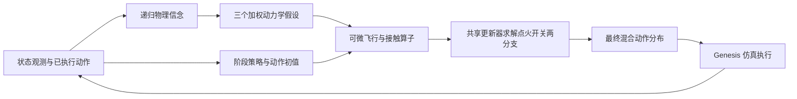

# 物理信念驱动的火箭着陆控制

[English](README.md) | [中文](README.zh-CN.md)

## 摘要

本工作在 aerospace-rl-benchmark 火箭着陆任务上，将在线动力学辨识、可微物理预测和动作优化集成到同一个策略网络中。模型根据已执行动作与状态变化维护递归物理信念，通过共享物理算子比较候选动作的后果，并由共享学习更新器完成有限步辨识与控制求解。最终动作采用离散点火与条件连续控制的联合分布，以真实仿真回报进行 PPO 优化，同时利用交互预测损失训练物理信念。

在冻结的原始环境与相同的 512 个初始状态下，当前模型取得 **428/512（83.59%）** 的基准成功率，DAgger 初始化策略为 **419/512（81.84%）**，净增加 9 个成功回合，提升 **1.76 个百分点**。本包包含对应的核心代码、训练配置、模型文件和逐回合评估记录。

## 1. 任务与总体结构

任务要求火箭通过翼面、发动机和万向节控制完成动力下降与着陆。策略接收原环境的 30 维状态观测，输出一个点火变量和六个连续控制量。真实仿真频率为 240 Hz，策略控制频率为 40 Hz，每个回合最长 1200 个控制步。



核心计算写为：

$$
b_t=\mathcal I_\psi(b_{t-1},s_{t-1},a_{t-1},s_t),\qquad
\hat s_{t+1}=F(s_t,a_t;\theta_t),\qquad
a_t\sim\pi_\psi(\cdot\mid s_t,b_t).
$$

其中，$b_t$ 表示根据真实交互更新的物理信念，$F$ 是可微物理算子，策略内部通过 $F$ 评价并调整候选动作。辨识与控制共享学习更新器；预测直接使用同一物理算子推进状态。

## 2. 模型设计

### 2.1 递归物理信念

内部物理状态由位置、世界系速度、四元数、角速度、翼面状态、发动机状态、万向节状态和燃料比例组成，共 21 维。`GRUCell(50, 64)` 编码上一状态、已执行动作与观测变化，每个环境维护 88 维记忆：64 维隐状态、12 维参数均值和 12 维尺度。

| 参数组 | 维数 | 物理作用 |
|---|---:|---|
| 有效推力/质量增益 | 1 | 动力输入与平动加速度的关系 |
| 三轴阻力增益 | 3 | 各方向速度相关阻力 |
| 横向、轴向惯量增益 | 2 | 力矩与角加速度的关系 |
| 翼面气动增益 | 1 | 翼面产生的气动力与力矩 |
| 发动机、万向节响应增益 | 2 | 执行器响应过程 |
| 接触刚度、阻尼、摩擦增益 | 3 | 支腿接触与切向滑动响应 |

模型以均值和沿固定方向的正负扰动构造三个参数假设。每个假设通过实际已执行动作解释新观测，以预测残差形成权重，并更新递归信念。这里估计的是任务相关的有效动力学系数。

### 2.2 可微物理算子

飞行算子包含六自由度刚体动力学、燃料相关质量与惯量、重力、阻力、翼面升阻力和力矩、推力矢量以及执行器响应。内部采用 40 Hz 宏步，并解析计算六个 240 Hz 执行器子步的端点与平均响应。

接触算子使用三条支腿的 12 个底部角点，计算着陆台与地面的柔顺法向力、阻尼和平滑滑动摩擦。该层为可微接触近似；真实交互、接触事件和回报仍由原始 Genesis 环境产生。

### 2.3 共享辨识与控制更新器

`SharedPhysicalUpdate` 根据当前变量、物理代价梯度、历史上下文、变量类型和任务模式，预测逐坐标步长：

$$
z^{i+1}=z^i-\eta_\psi(z^i,\nabla_z E,c,\mathrm{type},\mathrm{mode})
\odot\tanh(\nabla_z E).
$$

辨识模式更新动力学参数假设，控制模式更新动作，两者使用同一组网络权重，各展开两次更新。控制时固定本次由交互得到的参数假设，实际交互预测损失负责训练信念分支。

### 2.4 动作初始化与风险敏感求解

DAgger 初始化策略采用共享特征主干和三个高度阶段专家，阶段边界为 10 米与 2 米。动作头在基础策略附近生成点火开、关两个分支的连续动作初值。

每个分支在三个物理假设下使用同一个候选动作，展开 **8 个控制步（0.2 秒）**。当前实现优化的是该时域内保持不变的动作。控制目标包含下降速度、横向回中、姿态、角速度及动作偏移，风险代价结合加权平均与最坏假设：

$$
J(a)=(1-\rho)\sum_k w_kJ_k(a)+\rho\max_kJ_k(a)
+3\lVert a-a_{\mathrm{ref}}\rVert^2.
$$

求解后的连续动作与初值按高度融合：

$$
\mu=a_0+\alpha(h)(a^*-a_0),\qquad
\alpha(h)=\sigma(\beta)\sigma((20-h)/3).
$$

当前检查点中 $\sigma(\beta)\approx0.2495$，$\rho\approx0.2497$。最终策略为点火 Bernoulli 与相应六维 Gaussian 的联合分布，PPO 的概率比、熵和 KL 均基于这份最终分布计算。

## 3. 训练方法

训练目标由 PPO、价值估计、物理预测、熵、动作锚定及 KL 约束组成：

$$
\mathcal L=\mathcal L_{\mathrm{PPO}}+0.5\mathcal L_V
+0.1\mathcal L_{\mathrm{pred}}-0.001\mathcal H
+0.002\mathcal L_{\mathrm{anchor}}
+0.0001\mathcal L_{\mathrm{control}}+\mathcal L_{\mathrm{KL}}.
$$

预测监督使用实际执行动作和对应的后继观测。回合终止与超时分别处理，超时只从复位前状态进行 bootstrap。每轮另取最多 16 个环境的四步序列，对递归信念进行一次截断反向传播。

训练奖励采用势函数差分、速度/姿态跟踪代价、首次成功奖励、碰撞惩罚、风险代价和成功后的停稳奖励。`settle` 配方在首次成功后的 64 步窗口内累计停稳奖励，并在达到时间条件且当前停稳时提前结束训练回合；评估使用原始回合终止规则。

| 项目 | 实验配置 |
|---|---:|
| Actor 参数量 / 新增参数量 | 340,658 / 63,382 |
| 并行环境数 / rollout 长度 | 2048 / 64 |
| 每轮采样转移数 | 131,072 |
| PPO epochs / minibatch | 2 / 131,072 |
| 初始训练微批次 | 32,768，按显存动态调整 |
| GPU 显存目标比例 | 0.94 |
| 基础策略 / 新模块 / Critic 学习率 | $5\times10^{-6}$ / $3\times10^{-5}$ / $10^{-4}$ |
| 折扣因子 / GAE 系数 | 0.999 / 0.98 |
| PPO clip / 目标联合 KL | 0.1 / 0.02 |
| 训练随机种子 | 730007 |
| 续训起点交互数 | 2,031,616 |
| 本轮新增交互数 | 4,194,304 |
| 检查点谱系累计交互数 | 6,225,920 |

工程实现采用 GPU 批量仿真、推理分块和训练微批次，根据实际显存峰值与可用空间调整分块；显存不足时缩小未提交批次重试。训练结束后切换到独立评估进程，释放训练图和优化器占用。续训恢复模型与优化器，仿真从新的回合开始。

## 4. 实验协议与结果

环境固定在上游提交 `39e6bb6fd5d0f5432f7405a76946938a469492ce`，保持原始动力学、float32 引擎精度和成功判据。评估使用四组各 128 个环境，随机种子为 `1000007 / 2000007 / 3000007 / 4000007`；每个环境只统计第一个回合，最终动作取确定性输出。两组策略的初始状态哈希逐组一致。

| 策略 | 成功回合 | 基准成功率 | 95% Wilson 区间 |
|---|---:|---:|---:|
| DAgger 初始化策略 | 419 / 512 | 81.84% | 78.26%–84.93% |
| 统一物理信念策略 | 428 / 512 | **83.59%** | 80.14%–86.55% |

同一初始状态下，新策略新增成功 79 回合、失去原有成功 70 回合，净增 9 回合。该比较反映本轮物理策略续训相对 DAgger 初始化的整体变化；对照对象是 DAgger 初始化策略，单次训练结果不用于归因某一个模块的独立贡献。

基准成功记录回合中曾满足接触、速度、角速度和倾角阈值的事件。终态另外记录：物理信念策略有 3/512 回合在终止时满足停稳条件，214/512 回合曾成功后又发生致命终止；两类指标分别保存在逐回合结果中。

实验文件：

- [物理信念策略逐回合结果](results/physical_belief_evaluation.json)
- [DAgger 对照结果](results/dagger_evaluation.json)
- [成对比较汇总](results/comparison.json)
- [训练记录清单](results/training_manifest.json)

## 5. 代码组织与运行

```text
algorithms/physical_belief_rocket_landing/
├── README.md                        # 英文技术报告
├── README.zh-CN.md                   # 中文技术报告
├── requirements.txt                 # 实际实验使用的依赖版本
├── configs/rocket_landing.json       # 火箭着陆续训参数
├── core/
│   ├── rocket_unified_physics.py     # 信念、共享更新器、接触与最终策略
│   ├── rocket_physical_core.py       # 可微飞行动力学
│   ├── rocket_phase_policy.py        # 三阶段基础策略
│   └── ...                          # 奖励适配及必要支持模块
├── scripts/
│   ├── run.py                       # 统一训练、评估入口
│   ├── train.py                     # PPO 与辅助预测训练
│   ├── evaluate.py                  # 四组固定初始状态评估
│   └── ...                          # 冻结环境加载与回合统计
├── vendor/benchmark_source.tar.gz    # 原始环境与资源快照
├── artifacts/                       # 最终模型、续训起点与 DAgger 权重
├── results/                         # 已完成实验的结果记录
└── provenance.json                  # 源码、模型哈希与整理说明
```

本目录随附三个检查点。环境源码和资源已随包冻结，无需原开发目录或 Git 历史。使用 Python 3.11，在 NVIDIA GPU 环境执行训练与完整评估。

```bash
cd algorithms/physical_belief_rocket_landing
python3.11 -m venv .venv
source .venv/bin/activate
python -m pip install -r requirements.txt
```

**评估已完成的模型：**

```bash
python scripts/run.py evaluate --out runs/evaluation --workers 4
```

结果写入 `runs/evaluation/evaluation/development512.json`。`--workers 1` 可按相同协议串行执行四组环境。

**按实验配置从保存的续训起点重新训练：**

```bash
python scripts/run.py train --out runs/retrain
```

该命令读取 `configs/rocket_landing.json`，从 `artifacts/continuation.pt` 追加本轮 4,194,304 次交互，随后评估。

**从当前最终模型继续追加训练：**

```bash
python scripts/run.py train --out runs/continue \
  --resume artifacts/policy.pt --total-transitions 10420224
```

`--total-transitions` 表示包含恢复历史在内的累计交互预算。输出目录须使用新名称，以保留已有模型和结果。

三个权重文件分别是：`policy.pt`（本报告模型）、`continuation.pt`（本轮续训起点）和 `parent/parent.pt`（DAgger 初始化及训练锚定策略）。训练输出包含模型、优化器、进度、配置与独立评估结果。

## 6. 实现范围与来源

当前实现面向状态观测下的固定火箭系统，使用三个参数假设、有效动力学系数和短时动作展开。物理信念的尺度用于组织多假设推演，尚未作统计校准。代码包保持已完成实验的模型和奖励实现，整理差异记录在 [provenance.json](provenance.json)，来源说明见 [NOTICE.md](NOTICE.md)。

基准仓库：[PaoShou-China/aerospace-rl-benchmark](https://github.com/PaoShou-China/aerospace-rl-benchmark)。

## 后续研究

正在训练的新候选引入因果可信度、共享掩码推断、动作序列优化和完整回合训练，见[研究方案](docs/CONFIDENCE_SEQUENCE_RESEARCH.md#中文说明)。新实验结果待完成后报告；上文检查点及已完成结果仍对应原实验。
